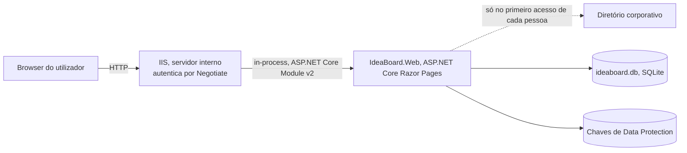
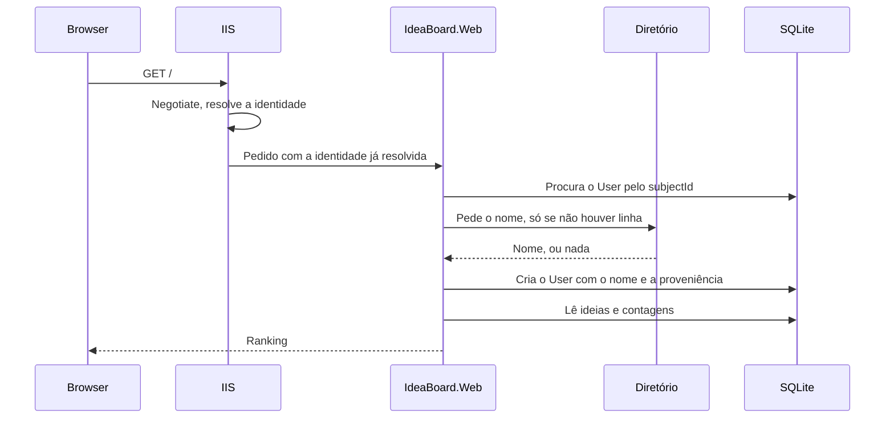

# 01. Arquitetura

**Versão 2, 13 de novembro de 2026.**

Pressupõe a leitura de [BRIEFING.md](../BRIEFING.md). Este documento descreve a forma
do sistema. As funcionalidades estão em [02](02-Especificacao-Funcional.md), os dados
em [03](03-Modelo-de-Dados.md), e cada decisão tem o seu registo em [ADR](ADR/).

## Princípio de desenho

A aplicação tem quatro funcionalidades, entre quinze e cinquenta utilizadores, e uma
escrita rara. Qualquer coisa que não caiba nessa realidade é complexidade a mais.

A arquitetura é por isso deliberadamente pequena: um processo, uma base de dados em
ficheiro, renderização no servidor e nenhuma API pública. A justificação de cada peça
está no ADR correspondente, e em todos eles a alternativa rejeitada foi rejeitada por
custo desproporcionado, não por incapacidade técnica.

## Visão geral



**Quem autentica é o IIS, e não a aplicação.** A identidade chega ao pedido já
resolvida, e a aplicação lê dela o identificador de segurança da conta. Não há
redirecionamento para um fornecedor externo, não há token para validar e não há cookie
de sessão. Ver [ADR-014](ADR/ADR-014-autenticacao-integrada-windows.md).

A única chamada externa é a consulta ao diretório corporativo para obter o nome
apresentável, e acontece uma vez por pessoa, no primeiro acesso. Depois disso a
aplicação trabalha só com a base de dados local.

Se o diretório não responder, a pessoa regista o seu nome à mão e continua, portanto a
indisponibilidade do diretório não impede o acesso. **O que impede o acesso é estar fora
da rede corporativa**, que é um custo aceite e está registado no ADR-014.

## Plataforma e versões

| Componente | Escolha | Registo |
|---|---|---|
| Runtime | .NET 10, versão de suporte alargado | |
| Aplicação | ASP.NET Core Razor Pages | [ADR-001](ADR/ADR-001-razor-pages.md) |
| Acesso a dados | EF Core 10, `Microsoft.EntityFrameworkCore.Sqlite` | [ADR-002](ADR/ADR-002-sqlite.md) |
| Autenticação | Integrada do Windows, por Negotiate no IIS | [ADR-014](ADR/ADR-014-autenticacao-integrada-windows.md) |
| Alojamento | IIS, hosting in-process | [ADR-009](ADR/ADR-009-publicacao-iis.md) |
| Testes | xUnit v3, `Microsoft.Playwright.Xunit.v3` | [ADR-017](ADR/ADR-017-xunit-v3.md), [ADR-016](ADR/ADR-016-identidade-nos-testes-por-host-proprio.md) |

Registo de eventos pelo `ILogger` com o provider de Event Log do Windows, que já vem
na plataforma, em vez de acrescentar uma biblioteca de logging.

## Estrutura da solução

Quatro projetos em `src`, com fronteiras que **não são camadas**. A divisão é por
artefacto publicável, e é por isso que não contradiz o
[ADR-006](ADR/ADR-006-projeto-unico.md), que recusou a divisão por camadas pelos
motivos que lá estão. Ver [ADR-015](ADR/ADR-015-estrutura-de-quatro-projetos.md).

```
IdeaBoard.sln
  src/IdeaBoard.App/           O produto inteiro, biblioteca de classes Razor
    Pages/                     Index, Recentes, Nova, Detalhe, Nome, erros
    Domain/                    Idea, Vote, User
    Data/                      IdeaBoardDbContext, Migrations/
    Services/                  IdeaService, VoteService, UserProvisioningService
    Configuration/             Validação da configuração no arranque
    Pipeline/                  Middleware próprio
    wwwroot/
  src/IdeaBoard.Web/           Host publicado. Só o arranque
  src/IdeaBoard.Local/         Host local, nunca publicado
  src/IdeaBoard.LocalIdentity/ Handler de identidade do host local
  tests/IdeaBoard.Tests/       xUnit v3, unidade e integração
```

A separação por pastas que o ADR-006 decidiu não desapareceu. Mudou de sítio e vive
agora dentro do `IdeaBoard.App`, com a mesma direção única de dependências.

**`tests/IdeaBoard.E2E/` ainda não existe nesta árvore.** Está a ser construído, e o
desenho dele está em [07](07-Plano-de-Verificacao.md). Fica aqui nomeado para que a
ausência se leia como trabalho em curso e não como esquecimento.

### Porque é que os hosts são dois

O `IdeaBoard.App` **não referencia projeto nenhum**, e é deliberado que seja a peça
burra. Os dois hosts são irmãos e referenciam no, e só o host local referencia também o
`IdeaBoard.LocalIdentity`.

Isto compra uma coisa que o projeto único não conseguia dar. A regra mais dura do
`CLAUDE.md`, que proíbe código de autenticação de teste dentro do host publicado, era
uma convenção defendida por revisão de código. Passa a ser um facto estrutural, porque
o handler vive num projeto que o host publicado não alcança.

**A proteção que o compilador dava de graça desapareceu na divisão**, e teve de ser
reposta à mão. Antes, uma referência do host publicado para o host local formava um
ciclo de projetos e o MSBuild recusava construir. Com os hosts irmãos esse ciclo não
existe, e uma referência errada compilaria, publicaria, e levaria o handler local para
produção.

O `Directory.Build.targets` repõe essa proteção, e a invariante que defende não é a que
parece. Não é que o `IdeaBoard.Web` só referencie o `IdeaBoard.App`, é que **nada
alcançável a partir do `IdeaBoard.Web` referencia um host**. Por isso a guarda vigia os
dois projetos, e o conjunto permitido do `IdeaBoard.App` está vazio: acrescentar uma
referência a um host faz hesitar quem a faz, e acrescentar uma à biblioteca partilhada
parece exatamente aquilo para que uma biblioteca partilhada serve.

### O prefixo dos ficheiros estáticos, que é o custo desta escolha

Uma biblioteca de classes Razor serve os ficheiros estáticos sob
`_content/IdeaBoard.App/`, e esse prefixo aparece nas referências do layout.

Uma página pode compilar na perfeição e a folha de estilos devolver 404, porque o
prefixo é configuração de servidor e não código. Compilar, arrancar e servir são três
coisas e só a primeira dá erro de compilação, e é por isso que existe um teste que
arranca o host publicado a sério e exige 200 no pedido do ficheiro de estilos.

O custo é que toda a referência a um ficheiro estático carrega o nome do projeto, e
mudar esse nome parte todas elas de uma vez.

### Responsabilidade de cada pasta

As pastas abaixo são as do `IdeaBoard.App`.

**`Pages`** contém os page models. Um page model valida a entrada, chama um serviço e
devolve uma página ou um redirect. Não contém regras de negócio nem acesso direto ao
`DbContext`.

**`Domain`** contém as entidades e as regras que não dependem de infraestrutura, como
os limites de tamanho e o critério de ordenação.

**`Data`** contém o `IdeaBoardDbContext`, a configuração do modelo e as migrações.

**`Services`** contém o que coordena domínio e dados. `IdeaService` para submissão e
listagem, `VoteService` para votar e retirar o voto, e `UserProvisioningService` para
o upsert do utilizador local no início de sessão.

Os serviços são registados com tempo de vida scoped e consumidos por interface, para
que os testes de unidade não precisem de base de dados.

## Fluxo de um pedido

### Primeiro acesso de uma pessoa



Quando o diretório não devolve nome, a aplicação **não cria a linha** e redireciona para
a página onde a pessoa regista o seu. A linha só nasce quando há nome para escrever, e é
isso que mantém a invariante de que toda a linha de utilizador tem nome, em vez de cada
página que mostra um autor ter de defender a ausência dele.

A criação do utilizador local acontece aqui e só aqui. A partir deste momento o nome
mostrado na aplicação vem da base de dados, e não da identidade do pedido, o que é o que
torna possível mostrar a lista nominal de votantes sem consultar o diretório a cada
leitura. A consequência está em
[ADR-004](ADR/ADR-004-tabela-local-de-utilizadores.md).

### Votar

O voto é um POST com token antiforgery, seguido de redirect, no padrão
POST/Redirect/GET. Sem JavaScript, o botão é um formulário normal e a página
recarrega. Com JavaScript, um pequeno script intercepta a submissão, envia o mesmo
POST por `fetch` e troca o botão e a contagem no sítio.

A melhoria progressiva é a razão pela qual a lógica vive no handler e não no script.
O script é uma conveniência de interface, e a aplicação está completa sem ele.

## Modelo de dados em resumo

Três tabelas, `User`, `Idea` e `Vote`, com um índice único em `Vote(ideaId, userId)`.
É esse índice que impõe a regra de um voto por pessoa por ideia ao nível da base de
dados, e não apenas no código. O detalhe está em [03](03-Modelo-de-Dados.md).

A contagem de votos é calculada por agregação na consulta e não guardada numa coluna.
Ver [ADR-005](ADR/ADR-005-contagem-calculada.md).

## Autenticação e autorização

Toda a aplicação exige utilizador autenticado. Não há páginas públicas, não há papéis
e não há permissões diferenciadas, porque o briefing estabelece que toda a gente
propõe e vota em igualdade.

A política de autorização global é aplicada como fallback, de forma a que uma página
nova nasça protegida por omissão em vez de exposta por esquecimento. O detalhe de
configuração está em [04](04-Requisitos-Nao-Funcionais-e-Seguranca.md) e os passos de
provisionamento em [06](06-Operacao-e-Publicacao.md).

## O que esta arquitetura não tem, e porquê

| Ausência | Razão |
|---|---|
| API HTTP pública | Não há consumidor. A interface é o único cliente |
| Cache distribuída ou Redis | Um processo, dezenas de utilizadores, leituras triviais |
| Camada de repositório sobre o EF Core | O `DbContext` já é essa abstração. Uma segunda só acrescenta indireção |
| Mensageria ou trabalho assíncrono | Nenhuma operação demora o suficiente para justificar |
| Ecrã de administração | Fora do âmbito por decisão do briefing. Ver [ADR-008](ADR/ADR-008-sem-administracao.md) |
| Contentores | O destino de publicação é um IIS interno já existente |

## Limites conhecidos

Nenhum destes é defeito. São consequências aceites da dimensão do problema, e ficam
registadas para que não sejam descobertas como surpresa.

**Um só processo de escrita.** O SQLite em modo WAL aceita leituras concorrentes e uma
escrita de cada vez. O pool de aplicações do IIS tem de estar limitado a um worker
process. Com esta carga a restrição nunca se nota, mas tem de estar configurada.

**Sem alta disponibilidade.** Uma máquina, um ficheiro. Uma falha do servidor é uma
indisponibilidade até alguém a resolver. É aceitável para uma ferramenta interna de
participação voluntária.

**Crescimento da lista.** O briefing nota que acima de cerca de cinquenta ideias a
navegação se degrada, sem pesquisa nem categorias. A arquitetura não resolve isso, por
decisão, e o sinal fica para observação depois do lançamento.
