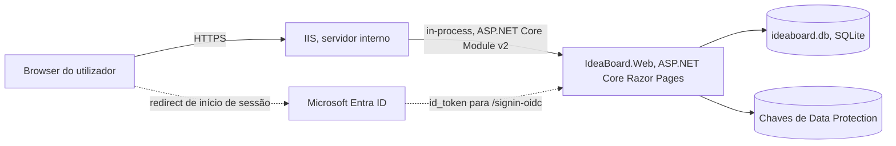
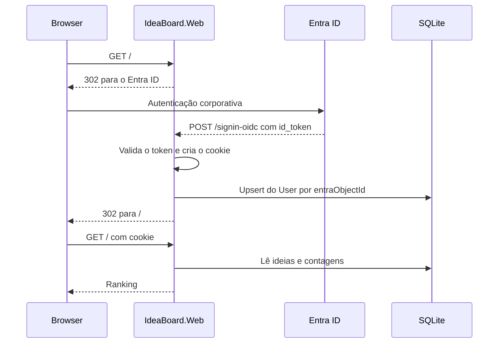

# 01. Arquitetura

**Versão 1, 30 de outubro de 2026.**

Pressupõe a leitura de [BRIEFING.md](../BRIEFING.md). Este documento descreve a forma
do sistema. As funcionalidades estão em [02](02-Especificacao-Funcional.md), os dados
em [03](03-Modelo-de-Dados.md), e cada decisão tem o seu registo em [ADR](ADR/).

## Princípio de desenho

A aplicação tem quatro funcionalidades, entre quinze e cinquenta utilizadores, e uma
escrita rara. Qualquer coisa que não caiba nessa realidade é complexidade a mais.

A arquitetura é por isso deliberadamente pequena: um processo, uma base de dados em
ficheiro, renderização no servidor e nenhuma API pública. A justificação de cada peça
está no ADR correspondente, e em todos eles a alternativa rejeitada foi rejeitada por
custo desproporcionado, não por incapacidade técnica.

## Visão geral



A ligação ao Entra ID acontece apenas no início de sessão. Depois disso a aplicação
trabalha só com o cookie de autenticação e com a base de dados local. Não há chamadas
ao Microsoft Graph nem a qualquer serviço externo durante a utilização normal, o que
significa que a aplicação continua a funcionar se o Entra ID estiver indisponível,
para quem já tenha sessão iniciada.

## Plataforma e versões

| Componente | Escolha | Registo |
|---|---|---|
| Runtime | .NET 10, versão de suporte alargado | |
| Aplicação | ASP.NET Core Razor Pages | [ADR-001](ADR/ADR-001-razor-pages.md) |
| Acesso a dados | EF Core 10, `Microsoft.EntityFrameworkCore.Sqlite` | [ADR-002](ADR/ADR-002-sqlite.md) |
| Autenticação | `Microsoft.Identity.Web` e `Microsoft.Identity.Web.UI` | [ADR-003](ADR/ADR-003-autenticacao-entra-id.md) |
| Alojamento | IIS, hosting in-process | [ADR-009](ADR/ADR-009-publicacao-iis.md) |
| Testes | xUnit, `Microsoft.Playwright.Xunit` | [ADR-011](ADR/ADR-011-autenticacao-nos-testes-e2e.md) |

Registo de eventos pelo `ILogger` com o provider de Event Log do Windows, que já vem
na plataforma, em vez de acrescentar uma biblioteca de logging.

## Estrutura da solução

Três projetos. A separação em camadas dentro do projeto web é por pastas, não por
assemblies, porque quatro funcionalidades não justificam fronteiras de compilação.
Ver [ADR-006](ADR/ADR-006-projeto-unico.md).

```
IdeaBoard.sln
  src/IdeaBoard.Web/
    Pages/                    Index, Recentes, Nova, Detalhe, erros
    Domain/                   Idea, Vote, User
    Data/                     IdeaBoardDbContext, Migrations/
    Services/                 IdeaService, VoteService, UserProvisioningService
    wwwroot/
  tests/IdeaBoard.Tests/      xUnit, unidade e integração
  tests/IdeaBoard.E2E/        xUnit mais Microsoft.Playwright.Xunit
    Fixtures/                 AppHostFixture, TestAuthHandler
    Scenarios/                Um ficheiro por funcionalidade
```

### Responsabilidade de cada pasta

**`Pages`** contém os page models. Um page model valida a entrada, chama um serviço e
devolve uma página ou um redirect. Não contém regras de negócio nem acesso direto ao
`DbContext`.

**`Domain`** contém as entidades e as regras que não dependem de infraestrutura, como
os limites de tamanho e o critério de ordenação.

**`Data`** contém o `IdeaBoardDbContext`, a configuração do modelo e as migrações.

**`Services`** contém o que coordena domínio e dados. `IdeaService` para submissão e
listagem, `VoteService` para votar e retirar o voto, e `UserProvisioningService` para
o upsert do utilizador local no início de sessão.

Os serviços são registados com tempo de vida scoped e consumidos por interface, para
que os testes de unidade não precisem de base de dados.

## Fluxo de um pedido

### Primeiro início de sessão



O upsert do utilizador local acontece aqui e só aqui. A partir deste momento o nome e
o email mostrados na aplicação vêm da base de dados, e não das claims, o que é o que
torna possível mostrar a lista nominal de votantes sem consultar o Entra ID. A
consequência está em [ADR-004](ADR/ADR-004-tabela-local-de-utilizadores.md).

### Votar

O voto é um POST com token antiforgery, seguido de redirect, no padrão
POST/Redirect/GET. Sem JavaScript, o botão é um formulário normal e a página
recarrega. Com JavaScript, um pequeno script intercepta a submissão, envia o mesmo
POST por `fetch` e troca o botão e a contagem no sítio.

A melhoria progressiva é a razão pela qual a lógica vive no handler e não no script.
O script é uma conveniência de interface, e a aplicação está completa sem ele.

## Modelo de dados em resumo

Três tabelas, `User`, `Idea` e `Vote`, com um índice único em `Vote(ideaId, userId)`.
É esse índice que impõe a regra de um voto por pessoa por ideia ao nível da base de
dados, e não apenas no código. O detalhe está em [03](03-Modelo-de-Dados.md).

A contagem de votos é calculada por agregação na consulta e não guardada numa coluna.
Ver [ADR-005](ADR/ADR-005-contagem-calculada.md).

## Autenticação e autorização

Toda a aplicação exige utilizador autenticado. Não há páginas públicas, não há papéis
e não há permissões diferenciadas, porque o briefing estabelece que toda a gente
propõe e vota em igualdade.

A política de autorização global é aplicada como fallback, de forma a que uma página
nova nasça protegida por omissão em vez de exposta por esquecimento. O detalhe de
configuração está em [04](04-Requisitos-Nao-Funcionais-e-Seguranca.md) e os passos de
provisionamento em [06](06-Operacao-e-Publicacao.md).

## O que esta arquitetura não tem, e porquê

| Ausência | Razão |
|---|---|
| API HTTP pública | Não há consumidor. A interface é o único cliente |
| Cache distribuída ou Redis | Um processo, dezenas de utilizadores, leituras triviais |
| Camada de repositório sobre o EF Core | O `DbContext` já é essa abstração. Uma segunda só acrescenta indireção |
| Mensageria ou trabalho assíncrono | Nenhuma operação demora o suficiente para justificar |
| Ecrã de administração | Fora do âmbito por decisão do briefing. Ver [ADR-008](ADR/ADR-008-sem-administracao.md) |
| Contentores | O destino de publicação é um IIS interno já existente |

## Limites conhecidos

Nenhum destes é defeito. São consequências aceites da dimensão do problema, e ficam
registadas para que não sejam descobertas como surpresa.

**Um só processo de escrita.** O SQLite em modo WAL aceita leituras concorrentes e uma
escrita de cada vez. O pool de aplicações do IIS tem de estar limitado a um worker
process. Com esta carga a restrição nunca se nota, mas tem de estar configurada.

**Sem alta disponibilidade.** Uma máquina, um ficheiro. Uma falha do servidor é uma
indisponibilidade até alguém a resolver. É aceitável para uma ferramenta interna de
participação voluntária.

**Crescimento da lista.** O briefing nota que acima de cerca de cinquenta ideias a
navegação se degrada, sem pesquisa nem categorias. A arquitetura não resolve isso, por
decisão, e o sinal fica para observação depois do lançamento.
