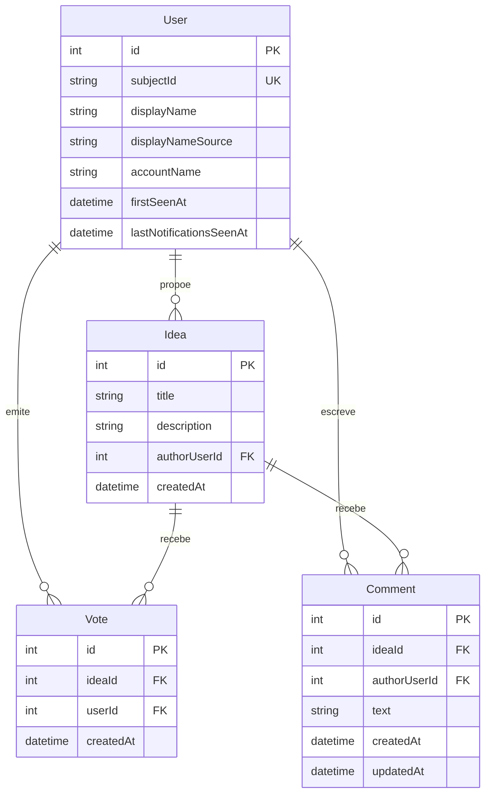

# 03. Modelo de dados

**Versão 3, 17 de novembro de 2026.**

Quatro tabelas. O comportamento que elas suportam está em
[02](02-Especificacao-Funcional.md).

## Diagrama

## Entidades

### User

Representa uma pessoa que já iniciou sessão pelo menos uma vez. A linha é criada no
primeiro início de sessão e nunca é apagada.

| Coluna | Tipo | Nulo | Notas |
|---|---|---|---|
| `id` | INTEGER | Não | Chave primária, autoincremento |
| `subjectId` | TEXT | Não | Identificador de segurança da conta, índice único |
| `displayName` | TEXT | Não | Nome apresentado em toda a aplicação |
| `displayNameSource` | TEXT | Não | De onde veio o nome, `Directory` ou `SelfRegistered` |
| `accountName` | TEXT | Não | A conta na forma `DOMINIO\pessoa` |
| `firstSeenAt` | TEXT | Não | UTC |
| `lastNotificationsSeenAt` | TEXT | Sim | UTC. Quando a pessoa abriu o separador pessoal pela última vez |

**A chave de correspondência é o `subjectId`.** O nome da coluna é deliberado e não é
um detalhe. Não se chama `windowsSid` nem `entraObjectId`, chama se pelo que é, que é o
identificador por que a pessoa é encontrada, e não pelo sítio de onde veio. O fornecedor
por trás dela já mudou uma vez, e uma coluna com o nome do fornecedor do dia garante um
segundo renomear na mudança seguinte. Ver
[ADR-023](ADR/ADR-023-chave-da-tabela-de-utilizadores.md).

**Não há coluna de email.** O `accountName` ocupa o lugar que ela ocupava, que era
distinguir à mão duas pessoas com o mesmo nome apresentado, e fá lo melhor, porque a
conta de domínio é única por construção e o email podia faltar.

O `displayNameSource` existe porque o nome pode vir do diretório ou ser escrito pela
própria pessoa quando a consulta não devolve nada, e porque é essa proveniência que
decide se uma consulta posterior o pode substituir. Ver
[ADR-022](ADR/ADR-022-resolucao-e-substituicao-do-nome.md).

O `lastNotificationsSeenAt` aceita nulo, e o nulo é o estado honesto de quem nunca abriu
a página. Entrou nulo em todas as linhas que já existiam quando a coluna passou a existir,
pela razão registada em [06](06-Operacao-e-Publicacao.md): um valor por omissão com a data
desse dia declararia em silêncio que toda a gente tinha acabado de ler tudo.

A razão de existir esta tabela, em vez de guardar o nome em cada voto, está em
[ADR-004](ADR/ADR-004-tabela-local-de-utilizadores.md).

### Idea

| Coluna | Tipo | Nulo | Notas |
|---|---|---|---|
| `id` | INTEGER | Não | Chave primária, autoincremento |
| `title` | TEXT | Não | Máximo 120 caracteres |
| `description` | TEXT | Não | Máximo 2000 caracteres |
| `authorUserId` | INTEGER | Não | Chave estrangeira para `User` |
| `createdAt` | TEXT | Não | UTC |

Sem coluna de estado, sem coluna de categoria e sem coluna de contagem de votos. As
duas primeiras porque não existem no produto, a terceira por decisão explicada em
[ADR-005](ADR/ADR-005-contagem-calculada.md).

Índice em `createdAt` descendente, que serve o separador Recentes.

### Vote

| Coluna | Tipo | Nulo | Notas |
|---|---|---|---|
| `id` | INTEGER | Não | Chave primária, autoincremento |
| `ideaId` | INTEGER | Não | Chave estrangeira para `Idea` |
| `userId` | INTEGER | Não | Chave estrangeira para `User` |
| `createdAt` | TEXT | Não | UTC, define a ordem da lista de votantes |

**Índice único em `(ideaId, userId)`.** É a peça central do modelo. A regra de um voto
por pessoa por ideia é imposta aqui, pela base de dados, e não por uma verificação no
código que uma condição de corrida possa contornar.

Retirar o voto apaga a linha. Não há coluna de voto ativo nem apagamento lógico,
porque nada no produto precisa do histórico de votos retirados, e guardá lo seria
recolher dados sem finalidade.

### Comment

Acrescentada a 17 de novembro de 2026, com o alargamento do âmbito descrito em F6 de
[02](02-Especificacao-Funcional.md).

| Coluna | Tipo | Nulo | Notas |
|---|---|---|---|
| `id` | INTEGER | Não | Chave primária, autoincremento |
| `ideaId` | INTEGER | Não | Chave estrangeira para `Idea` |
| `authorUserId` | INTEGER | Não | Chave estrangeira para `User` |
| `text` | TEXT | Não | Máximo 2000 caracteres, o mesmo limite da descrição de uma ideia |
| `createdAt` | TEXT | Não | UTC, define a ordem da conversa |
| `updatedAt` | TEXT | Sim | UTC, ou nulo se o comentário nunca foi mudado |

Índice em `(ideaId, createdAt)`, que serve a leitura da conversa de uma ideia, e índice em
`authorUserId`, pela chave estrangeira.

**O `updatedAt` aceita nulo de propósito.** Nulo quer dizer que ninguém lhe mexeu, e é
isso que permite à página dizer que um comentário foi editado sem ter de comparar duas
datas e decidir quanto é que duas datas têm de estar próximas para contarem como o mesmo
instante.

**Não há coluna de estado nem apagamento lógico.** Apagar um comentário apaga a linha, e a
razão está em F6: um vazio visível seria uma afirmação sobre uma pessoa feita à frente das
outras, e este produto não tem moderação por dentro para a tomar.

**A posse é uma coluna e não um papel.** O `authorUserId` é a única coisa que decide quem
pode mudar ou apagar, e a verificação vive dentro da consulta que carrega a linha, e não
numa verificação feita depois sobre uma linha já carregada.

## Chaves estrangeiras e apagamento

Comportamento de apagamento restritivo em todas as relações, incluindo as duas de
`Comment`. Nenhuma operação da aplicação apaga `User` ou `Idea`, portanto a cascata nunca
seria exercida em funcionamento normal. Deixá la ativa só tornaria mais fácil apagar dados
por engano durante uma correção manual.

**Duas tabelas perdem linhas por acção de uma pessoa**, e vale a pena dizê lo aqui porque
é fácil ler o parágrafo acima como se nada fosse apagado. `Vote` perde a linha quando
alguém retira o voto, e `Comment` quando o autor apaga o que escreveu. Nenhuma das duas
apaga seja o que for de outra pessoa.

**Nota de configuração**: o SQLite só aplica chaves estrangeiras com
`PRAGMA foreign_keys = ON`. O provider do EF Core ativa isto nas ligações que abre,
mas uma sessão aberta à mão com a linha de comandos do `sqlite3` não o faz. Relevante
para o procedimento de correção manual descrito em
[06](06-Operacao-e-Publicacao.md).

## Datas

Todas as datas são guardadas em UTC e convertidas para a hora local apenas na
apresentação. O servidor está em Portugal e as mudanças de hora legal acontecem duas
vezes por ano, o que basta para que guardar hora local produza ambiguidades uma noite
por ano.

## Configuração EF Core

O mapeamento é feito por Fluent API em `OnModelCreating`, não por data annotations nas
entidades, para que as entidades de domínio não carreguem conhecimento de persistência.

Pontos que têm de estar na configuração:

- Índice único em `User.subjectId`.
- Índice único em `Vote(ideaId, userId)`, com nome explícito para que a deteção da
  violação não dependa de um nome gerado por convenção.
- Comprimentos máximos de `Idea.title`, `Idea.description` e `Comment.text`.
- Índice em `Comment(ideaId, createdAt)`, que é a ordem por que a conversa é lida.
- Comportamento de apagamento restritivo nas chaves estrangeiras.

O SQLite não aplica comprimentos máximos de coluna, portanto o limite de 120 e de 2000
caracteres é imposto pela validação da aplicação. A configuração do modelo declara os
limites na mesma, porque é ela que os documenta e porque é ela que passaria a ter
efeito se a base de dados alguma vez mudar.

## Consultas principais

**Ranking.** Agregação dos votos por ideia, com junção ao autor, ordenada por
contagem descendente, data descendente e identificador descendente. Uma só consulta,
sem carregamento separado por ideia.

**Recentes.** A mesma projeção, ordenada por data descendente e identificador
descendente.

**Detalhe.** A ideia, o autor, os votantes ordenados pela data do voto ascendente, e os
comentários ordenados pela data ascendente, com o desempate pelo identificador. Se cada
comentário pertence a quem está a ver decide se a partir do identificador já em mão, e não
com uma consulta por comentário.

**Estado do botão de voto.** Em ambas as listas, é preciso saber em que ideias a
pessoa autenticada já votou. Resolve se com uma única consulta que devolve os
identificadores das ideias votadas por essa pessoa, e não com uma consulta por linha.
Este é o único sítio do produto onde é fácil criar um problema de N mais 1, e por isso
fica registado aqui.

Todas as consultas de leitura usam `AsNoTracking`, porque nenhuma delas é seguida de
escrita sobre as entidades lidas.

## Migrações

Migrações do EF Core, versionadas no repositório.

**Aplicadas como passo explícito da publicação**, por script SQL gerado a partir das
migrações, e nunca automaticamente no arranque da aplicação. Um arranque que migra
sozinho dá uma alteração de esquema sem supervisão, sem backup prévio e sem
oportunidade de a rever.

**O script não é idempotente, e não pode ser.** O EF Core recusa gerar scripts
idempotentes para SQLite. A aplicação é por isso enquadrada por verificação antes e
depois, em vez de por idempotência, conforme
[ADR-020](ADR/ADR-020-migracoes-sem-idempotencia.md).

O procedimento está em [06](06-Operacao-e-Publicacao.md).

Nos testes a regra é outra, por serem bases de dados descartáveis criadas e destruídas
na própria execução. Ver [07](07-Plano-de-Verificacao.md).

## Volume esperado

Para dimensionar expectativas, não para planear capacidade.

| Tabela | Linhas ao fim de um ano |
|---|---|
| `User` | Entre 15 e 50 |
| `Idea` | Entre 20 e 150 |
| `Vote` | Entre algumas centenas e alguns milhares |
| `Comment` | Sem estimativa. A tabela é de 17 de novembro de 2026 e não há uso observado |

O ficheiro da base de dados mantém se na ordem dos poucos megabytes. Qualquer consulta
desta aplicação percorre a tabela inteira em tempo irrelevante, e os índices existem
por correção e por hábito, não por necessidade de desempenho.
