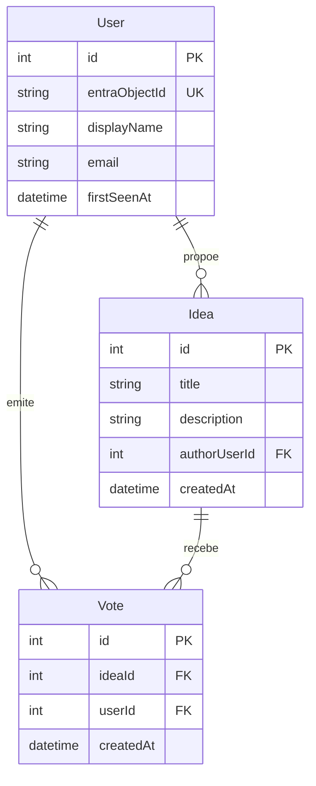

# 03. Modelo de dados

**Versão 2, 13 de novembro de 2026.**

Três tabelas. O comportamento que elas suportam está em
[02](02-Especificacao-Funcional.md).

## Diagrama

## Entidades

### User

Representa uma pessoa que já iniciou sessão pelo menos uma vez. A linha é criada no
primeiro início de sessão e nunca é apagada.

| Coluna | Tipo | Nulo | Notas |
|---|---|---|---|
| `id` | INTEGER | Não | Chave primária, autoincremento |
| `entraObjectId` | TEXT | Não | Identificador de objeto do Entra ID, índice único |
| `displayName` | TEXT | Não | Nome apresentado em toda a aplicação |
| `email` | TEXT | Não | Guardado para identificação, não apresentado na interface |
| `firstSeenAt` | TEXT | Não | UTC |

A chave de correspondência é o `entraObjectId`, nunca o email. O email de uma pessoa
pode mudar, por casamento ou por mudança de nome na organização, e o identificador de
objeto não muda. Usar o email como chave produziria utilizadores duplicados no dia em
que alguém mudasse de nome.

A razão de existir esta tabela, em vez de guardar o nome em cada voto ou de consultar
o Microsoft Graph, está em
[ADR-004](ADR/ADR-004-tabela-local-de-utilizadores.md).

### Idea

| Coluna | Tipo | Nulo | Notas |
|---|---|---|---|
| `id` | INTEGER | Não | Chave primária, autoincremento |
| `title` | TEXT | Não | Máximo 120 caracteres |
| `description` | TEXT | Não | Máximo 2000 caracteres |
| `authorUserId` | INTEGER | Não | Chave estrangeira para `User` |
| `createdAt` | TEXT | Não | UTC |

Sem coluna de estado, sem coluna de categoria e sem coluna de contagem de votos. As
duas primeiras porque não existem no produto, a terceira por decisão explicada em
[ADR-005](ADR/ADR-005-contagem-calculada.md).

Índice em `createdAt` descendente, que serve o separador Recentes.

### Vote

| Coluna | Tipo | Nulo | Notas |
|---|---|---|---|
| `id` | INTEGER | Não | Chave primária, autoincremento |
| `ideaId` | INTEGER | Não | Chave estrangeira para `Idea` |
| `userId` | INTEGER | Não | Chave estrangeira para `User` |
| `createdAt` | TEXT | Não | UTC, define a ordem da lista de votantes |

**Índice único em `(ideaId, userId)`.** É a peça central do modelo. A regra de um voto
por pessoa por ideia é imposta aqui, pela base de dados, e não por uma verificação no
código que uma condição de corrida possa contornar.

Retirar o voto apaga a linha. Não há coluna de voto ativo nem apagamento lógico,
porque nada no produto precisa do histórico de votos retirados, e guardá lo seria
recolher dados sem finalidade.

## Chaves estrangeiras e apagamento

Comportamento de apagamento restritivo em todas as relações. Nenhuma operação da
aplicação apaga `User` ou `Idea`, portanto a cascata nunca seria exercida em
funcionamento normal. Deixá la ativa só tornaria mais fácil apagar dados por engano
durante uma correção manual.

**Nota de configuração**: o SQLite só aplica chaves estrangeiras com
`PRAGMA foreign_keys = ON`. O provider do EF Core ativa isto nas ligações que abre,
mas uma sessão aberta à mão com a linha de comandos do `sqlite3` não o faz. Relevante
para o procedimento de correção manual descrito em
[06](06-Operacao-e-Publicacao.md).

## Datas

Todas as datas são guardadas em UTC e convertidas para a hora local apenas na
apresentação. O servidor está em Portugal e as mudanças de hora legal acontecem duas
vezes por ano, o que basta para que guardar hora local produza ambiguidades uma noite
por ano.

## Configuração EF Core

O mapeamento é feito por Fluent API em `OnModelCreating`, não por data annotations nas
entidades, para que as entidades de domínio não carreguem conhecimento de persistência.

Pontos que têm de estar na configuração:

- Índice único em `User.entraObjectId`.
- Índice único em `Vote(ideaId, userId)`, com nome explícito para que a deteção da
  violação não dependa de um nome gerado por convenção.
- Comprimentos máximos de `Idea.title` e `Idea.description`.
- Comportamento de apagamento restritivo nas chaves estrangeiras.

O SQLite não aplica comprimentos máximos de coluna, portanto o limite de 120 e 2000
caracteres é imposto pela validação da aplicação. A configuração do modelo declara os
limites na mesma, porque é ela que os documenta e porque é ela que passaria a ter
efeito se a base de dados alguma vez mudar.

## Consultas principais

**Ranking.** Agregação dos votos por ideia, com junção ao autor, ordenada por
contagem descendente, data descendente e identificador descendente. Uma só consulta,
sem carregamento separado por ideia.

**Recentes.** A mesma projeção, ordenada por data descendente e identificador
descendente.

**Detalhe.** A ideia, o autor, e os votantes ordenados pela data do voto ascendente.

**Estado do botão de voto.** Em ambas as listas, é preciso saber em que ideias a
pessoa autenticada já votou. Resolve se com uma única consulta que devolve os
identificadores das ideias votadas por essa pessoa, e não com uma consulta por linha.
Este é o único sítio do produto onde é fácil criar um problema de N mais 1, e por isso
fica registado aqui.

Todas as consultas de leitura usam `AsNoTracking`, porque nenhuma delas é seguida de
escrita sobre as entidades lidas.

## Migrações

Migrações do EF Core, versionadas no repositório.

**Aplicadas como passo explícito da publicação**, por script SQL gerado a partir das
migrações, e nunca automaticamente no arranque da aplicação. Um arranque que migra
sozinho dá uma alteração de esquema sem supervisão, sem backup prévio e sem
oportunidade de a rever.

**O script não é idempotente, e não pode ser.** O EF Core recusa gerar scripts
idempotentes para SQLite. A aplicação é por isso enquadrada por verificação antes e
depois, em vez de por idempotência, conforme
[ADR-020](ADR/ADR-020-migracoes-sem-idempotencia.md).

O procedimento está em [06](06-Operacao-e-Publicacao.md).

Nos testes a regra é outra, por serem bases de dados descartáveis criadas e destruídas
na própria execução. Ver [07](07-Plano-de-Verificacao.md).

## Volume esperado

Para dimensionar expectativas, não para planear capacidade.

| Tabela | Linhas ao fim de um ano |
|---|---|
| `User` | Entre 15 e 50 |
| `Idea` | Entre 20 e 150 |
| `Vote` | Entre algumas centenas e alguns milhares |

O ficheiro da base de dados mantém se na ordem dos poucos megabytes. Qualquer consulta
desta aplicação percorre a tabela inteira em tempo irrelevante, e os índices existem
por correção e por hábito, não por necessidade de desempenho.
