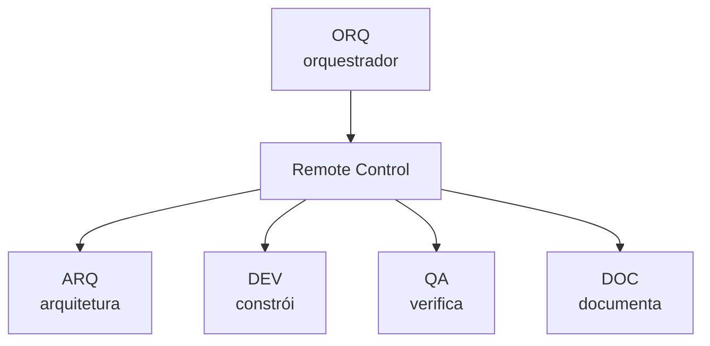
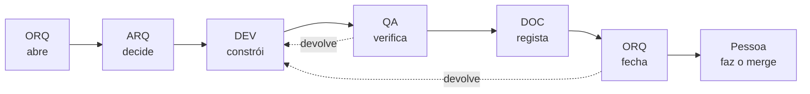
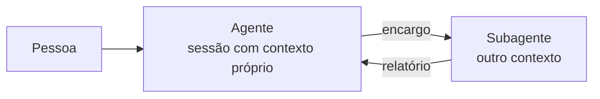
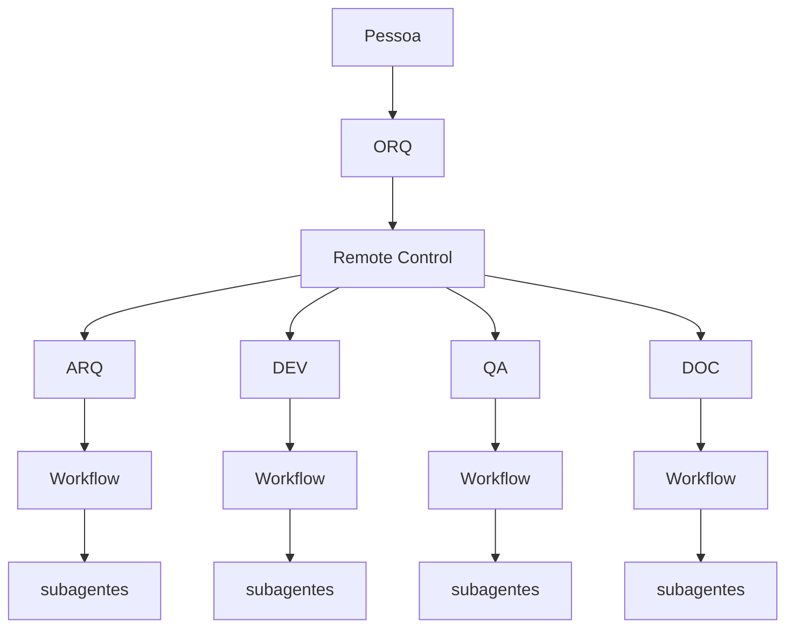
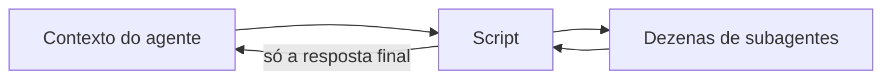
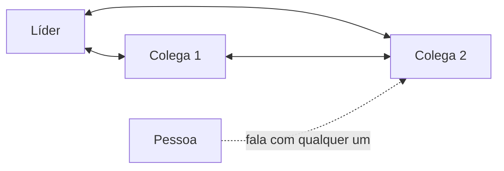
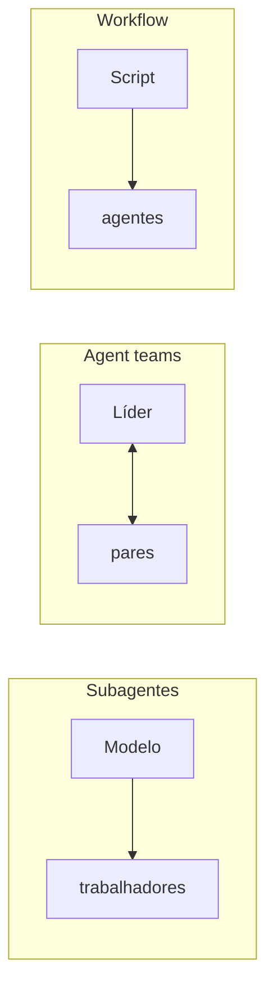

# Agentes e colaboração agêntica

**Nota de apresentação. Versão 6, 13 de novembro de 2026.**

Material de apoio para uma apresentação interna sobre as formas de colaboração entre
agentes, e como é que este projeto as usa na prática.

Não é documentação do produto. Os documentos numerados de `Docs/` descrevem a
plataforma de ideias. Este descreve a forma de trabalhar que a constrói.

Público alvo: colegas de TI e de produto que já usaram um assistente de código, mas que
nunca puseram vários a trabalhar ao mesmo tempo. Duração estimada, vinte minutos
com perguntas no fim.

## Como usar este documento

Cada `##` é um diapositivo. Os pontos são o que vai projetado, e **Para dizer** é a nota
do orador, que não vai projetada.

A ordem é deliberada. Começa no caso concreto deste repositório, e só depois generaliza
para o vocabulário e para as ferramentas. Quem assiste vê primeiro uma coisa que existe,
e só depois a teoria que a explica.

Sete diapositivos têm um diagrama em Mermaid, que o GitHub desenha sozinho ao abrir o
ficheiro, e o Visual Studio Code também com a extensão de pré visualização. Se exportar
os diapositivos para outra ferramenta, confirme que ela suporta Mermaid, ou exporte cada
diagrama para imagem antes de apresentar. Nesses diapositivos o diagrama é o que vai
projetado em grande, e os pontos ficam reduzidos a legenda.

**Ponto por fechar.** [08-Prompts-dos-Agentes.md](../08-Prompts-dos-Agentes.md) descreve
quatro papéis e não menciona subagentes. Esta nota descreve cinco papéis, com o de
Arquitetura, e descreve os subagentes que cada um lança. A diferença fica assinalada e
não resolvida aqui, porque alinhar o documento com a prática, ou a prática com o
documento, é decisão de quem é dono daqueles ficheiros.

---

## 1. O ponto de partida

- Um assistente de código numa janela resolve bem tarefas de uma pessoa.
- Degrada se quando o trabalho tem papéis com interesses diferentes.
- Quem escreve o código é mau juiz de se o código está certo.
- Esse problema é antigo, e a resposta também: separar quem constrói de quem verifica.

**Para dizer.** Este é o único diapositivo sem nada de novo. Toda a gente na sala já sabe
por que razão não se revê o próprio código. O que é novo é que agora a separação também
se pode aplicar a agentes, e que a decisão de os separar ou não tem consequências que se
medem.

---

## 2. Quem comanda quem



Cada caixa de papel é uma sessão separada, e o orquestrador fala com as quatro pelo mesmo
caminho, o Remote Control, que é o que lhe permite falar com sessões que não são a dele.

| Papel | É dono de | Nunca toca em |
|---|---|---|
| **ARQ** | Decisões de arquitetura e ADR | A definir |
| **DEV** | `src/`, `tests/IdeaBoard.Tests/` | `tests/IdeaBoard.E2E/`, `Docs/` |
| **QA** | `tests/IdeaBoard.E2E/`, verificação manual | `src/`, `tests/IdeaBoard.Tests/` |
| **DOC** | `Docs/`, `README.md`, `CLAUDE.md` | `src/`, `tests/` |
| **ORQ** | Nada | Todos os ficheiros do repositório |

As fronteiras de ficheiros do ARQ ainda não estão escritas, e ficam marcadas como
abertas em vez de inventadas aqui. Há sobreposição por resolver com o DOC, que hoje é
dono de `Docs/` por inteiro, incluindo os ADR.

**Para dizer.** Reparem na única caixa que não é dona de nada. O orquestrador não escreve
ficheiros, e essa é a característica que o define. Um coordenador que possa corrigir uma
coisa pequena passa a ser um quinto implementador, e perde a independência que é a única
coisa que tem para dar.

Esta é só a camada de cima. Cada uma das quatro caixas de baixo comanda agentes próprios,
e isso está no diapositivo 6.

---

## 3. As fronteiras não são burocracia

- Um QA que possa alterar `src/` acaba a fazer o teste passar.
- Um agente de documentação que possa alterar código acaba a corrigir a realidade para
  bater certo com o documento.
- Um documento corrigido em silêncio transforma um defeito em especificação.

**Para dizer.** Isto não é desconfiança do modelo, é desenho. Qualquer agente, humano ou
não, otimiza para o sinal que lhe damos. Se o sinal for "o teste tem de passar", e a
ferramenta permitir editar o teste, uma dessas duas coisas vai ceder, e não vai ser o
sinal.

A regra escrita no prompt do QA diz isto de forma direta. Um teste que falha é
informação, e um teste alterado para deixar de falhar é informação destruída.

---

## 4. Como se revezam



Um de cada vez. Enquanto um trabalha, os outros estão parados.

**Para dizer.** As duas setas tracejadas são o trabalho verdadeiro. A linha de cima só
corre do princípio ao fim quando nada falha, e isso é raro.

A parte contraintuitiva é a palavra "parados". Isto é mais lento do que pôr os cinco a
trabalhar em paralelo, e é uma escolha. Evita por completo a classe de problemas em que
um agente revê código que entretanto já mudou, e essa classe de problemas é cara de
diagnosticar porque os sintomas não apontam para a causa.

A última caixa também é uma escolha. Nenhum agente faz merge para `main`.

---

## 5. Agente e subagente



- Um **agente** é um modelo com ferramentas, num ciclo de decidir e agir até ao fim.
- Um **subagente** é outro agente que o primeiro lança, com contexto próprio, e que
  responde só a quem o lançou.
- As ferramentas do subagente podem ser restringidas, por exemplo só leitura.

**Para dizer.** Só interessam aqui duas ideias. A primeira é que o subagente só sabe o
que lhe escrevemos no encargo, e nós só vemos o que ele nos escreve no relatório. São
dois estreitamentos, e nenhum dos lados vê o que o outro perdeu.

A segunda é a restrição de ferramentas. Um subagente revisor a quem se tira a permissão
de escrever não pode corrigir o que devia estar a avaliar, e isso não é uma instrução que
ele possa ignorar. É a mesma ideia do diapositivo 3, imposta pela máquina em vez de pelo
prompt. Por isso a pergunta de segurança sobre um agente é sempre que ferramentas é que
ele tem, e nunca que modelo é que usa.

---

## 6. O retrato completo



Três camadas e dois mecanismos diferentes. O orquestrador comanda os quatro papéis por
**Remote Control**, porque cada um é uma sessão separada. Cada papel lança os seus
subagentes por **workflow**, dentro da sua própria sessão.

**Para dizer.** É este o desenho que temos hoje, e há três coisas a reparar nele.

A diferença entre as duas caixas de mecanismo não é de escala, é de natureza. O Remote
Control liga sessões que continuam separadas, cada uma com a sua janela de contexto e a
sua conversa, e liga as quatro pelo mesmo caminho. O workflow lança subagentes que vivem
e morrem dentro de uma sessão só. Um papel continua lá depois de responder, um subagente
não.

A primeira é que o orquestrador não tem workflow por baixo, e isso é deliberado. Quem
coordena não executa, e se ele começasse a lançar agentes próprios estaria a fazer o
trabalho que acabou de distribuir.

A segunda é que os quatro ramos não comunicam entre si. Um subagente do QA não fala com
um subagente do DEV, e o que cada ramo descobriu só sobe pelo relatório do seu agente. O
orquestrador é o único ponto onde os quatro se encontram, e é por isso que o que cai
entre eles é problema dele.

---

## 7. Quando um subagente compensa e quando não

Compensa quando:

- A tarefa é de leitura larga, e só interessa a conclusão.
- Há trabalho independente que pode correr ao mesmo tempo.
- Queremos uma segunda leitura que não esteja ancorada na primeira.

Não compensa quando:

- São três comandos que se correm na mesma.
- Já sabemos onde está a resposta.
- O encargo é difícil de escrever. Se não se consegue escrever bem, ainda não se percebeu
  a tarefa.

**Para dizer.** Há aqui um custo que não aparece na fatura mas aparece na qualidade. Um
subagente a quem se entrega a nossa hipótese tende a devolvê la confirmada. Se o que
queremos é uma revisão independente, damos lhe o código, não a conclusão a que já
chegámos.

---

## 8. A ferramenta Workflow



- O plano está escrito em código, e não decidido turno a turno pelo modelo.
- `agent()` lança um, `parallel()` corre vários ao mesmo tempo, `pipeline()` corre um por
  cada item de uma lista.
- Os resultados intermédios vivem em variáveis do script, fora da janela de contexto.
- É retomável, e os passos já concluídos não voltam a correr.

**Para dizer.** Isto é o que está por baixo de cada uma das quatro caixas do diapositivo
6. Podem ter corrido ali dentro vinte subagentes, e o que volta à janela de contexto do
agente é a resposta final, e mais nada. É por isso que o DEV consegue mandar rever vinte
ficheiros sem gastar a sua própria janela de contexto a lê los.

A vantagem é escalar. A desvantagem, menos óbvia, é deixar de se adaptar. Um script faz o
que está escrito, mesmo quando o que está escrito deixou de fazer sentido a meio.

---

## 9. Agent teams



- Várias sessões independentes, cada uma com a sua janela de contexto.
- Lista de tarefas partilhada e mensagens diretas entre colegas.
- Funcionalidade experimental, desligada por omissão, e precisa de sessão interativa.
- Rende em investigação, em módulos sem sobreposição e em hipóteses concorrentes.

**Para dizer.** Comparem com o diapositivo 6. Lá os quatro ramos não se falam, e tudo
passa pelo orquestrador. Aqui os colegas falam entre si, e nós entramos em qualquer ponto
sem passar pelo líder.

É a forma mais próxima do que já temos. O Remote Control dá nos a parte de o
orquestrador falar com sessões separadas. O que uma equipa acrescenta a isso é a lista de
tarefas partilhada e os colegas a falarem uns com os outros sem passar pelo líder, e é
precisamente essa parte que hoje não existe.

O custo é real e aparece em tokens. Uma equipa gasta bastante mais do que uma sessão, e
só compensa quando os colegas conseguem mesmo trabalhar sem esperar uns pelos outros.

---

## 10. O diapositivo que resume tudo: quem segura o plano



| | Subagentes | Skills | Agent teams | Workflows |
|---|---|---|---|---|
| Quem decide o passo seguinte | O modelo | O modelo | O líder | O script |
| Onde ficam os resultados intermédios | No contexto | No contexto | Em lista partilhada | Em variáveis |
| O que é repetível | O trabalhador | As instruções | A equipa | A orquestração |
| Escala | Algumas por turno | Igual | Alguns pares | Centenas |
| Se for interrompido | Reinicia o turno | Reinicia o turno | Os colegas continuam | Retoma onde ia |

**Para dizer.** Se levarem um diapositivo desta apresentação, levem este. As colunas não
competem, resolvem problemas diferentes, e a pergunta que as distingue é sempre a mesma:
quem segura o plano, e onde é que ficam as coisas a meio.

As skills não aparecem no desenho de propósito, porque não têm forma própria. São
instruções que o modelo carrega, e a forma continua a ser a da esquerda.

---

## 11. O que este projeto usa, e o que não usa

- **Remote Control na camada de cima.** O orquestrador fala diretamente com as quatro
  sessões, sem ninguém a copiar texto entre janelas.
- **Workflow na camada de baixo**, dentro de cada um dos quatro papéis.
- **Não usa agent teams.** Falta a lista partilhada e os papéis a falarem entre si.
- **A pessoa entra em dois sítios.** Abre o trabalho, e faz o merge no fim.

**Para dizer.** A escolha que interessa aqui é a de não fundir as sessões. O Remote
Control transporta o encargo e o relatório, e não funde contextos, por isso o QA continua
a verificar sem nunca ter visto o raciocínio do DEV.

Se o objetivo fosse só velocidade, uma sessão única com tudo lá dentro seria mais rápida,
e seria exatamente aquilo que o diapositivo 3 diz para não fazer.

O prompt do orquestrador já previa isto antes de estar ligado: se as sessões dos agentes
estiverem acessíveis a partir dele, fala com elas diretamente, e se não estiverem,
entrega o encargo à pessoa para ela o colar na sessão certa. Hoje estamos no primeiro
caso.

---

## Glossário rápido

| Termo | Em uma frase |
|---|---|
| Agente | Modelo com ferramentas, num ciclo de decidir e agir. |
| Subagente | Agente separado, com contexto próprio, lançado por outro. |
| Janela de contexto | Tudo o que o modelo tem à vista naquele momento. |
| Encargo | O texto que se entrega a um agente, e a única coisa que ele sabe. |
| Workflow | Script que orquestra muitos subagentes fora do contexto do modelo. |
| Remote Control | Ligação que deixa uma sessão falar com outra sessão. |
| Agent team | Várias sessões independentes com líder, lista partilhada e mensagens. |
| Skill | Instruções empacotadas que o modelo carrega quando a tarefa as pede. |
| ADR | Registo de uma decisão, com alternativas e consequências. |

## Fontes

Documentação do Claude Code, consultada a 13 de novembro de 2026:

- `code.claude.com/docs/en/sub-agents`
- `code.claude.com/docs/en/workflows`
- `code.claude.com/docs/en/agent-teams`
- `code.claude.com/docs/en/plugins/components`

Do próprio repositório:

- [BRIEFING.md](../../BRIEFING.md), âmbito e riscos assumidos
- [05-Plano-de-Entrega.md](../05-Plano-de-Entrega.md), as fases que os agentes percorrem
- [07-Plano-de-Verificacao.md](../07-Plano-de-Verificacao.md), o que o QA cobre e o que
  fica para verificação manual
- [08-Prompts-dos-Agentes.md](../08-Prompts-dos-Agentes.md), os quatro papéis e os
  prompts de arranque

---

## Anexo: o mesmo desenho com o GitHub Copilot SDK

Não é diapositivo. É material para a pergunta que costuma aparecer no fim, se isto só
funciona com uma ferramenta ou se o desenho é transportável.

É transportável, e a peça que o transporta é o Copilot SDK, que arranca a Copilot CLI e
fala com ela por JSON RPC. O pacote de .NET traz a CLI incluída, portanto não há segunda
instalação:

```bash
dotnet add package GitHub.Copilot.SDK
```

### O que muda em relação ao que temos

| Camada de hoje | Com o SDK |
|---|---|
| ORQ, um agente que decide | Um programa seu, que decide por código |
| Remote Control entre sessões | `CreateSessionAsync` com identificador próprio por papel |
| Sessões que sobrevivem ao fecho | Estado persistido, e retomável pelo mesmo identificador |
| Fronteiras de ficheiros no prompt | Handler de permissões, que recusa a escrita em vez de a desaconselhar |

A primeira linha é a perda. O orquestrador deixa de ser um agente que lê três relatórios
e repara no que caiu entre eles, e passa a ser código determinístico. Quem quiser os dois
tem de dar ao agente orquestrador uma ferramenta que embrulhe este programa.

A última linha é o ganho, e é maior do que parece. Hoje a fronteira do QA é uma frase no
prompt, e um agente convencido de que o teste é que está mal pode atravessá la. Aqui a
escrita é recusada pelo processo que está por fora, e nenhuma instrução a convence.

### Abrir uma sessão por papel, com a fronteira imposta

```csharp
using GitHub.Copilot.SDK;

/// <summary>
/// Opens one Copilot session per role, each refused write access outside the files
/// that role owns.
/// </summary>
public class RoleOrchestrator
{
    private readonly CopilotClient client;

    public RoleOrchestrator(CopilotClient client)
    {
        this.client = client;
    }


    /// <summary>
    /// Opens a named, resumable session bound to one role and the path it owns.
    /// </summary>
    public async Task<Session> OpenRoleAsync(string roleName, string ownedPath)
    {
        SessionConfig config = new SessionConfig();
        config.SessionId = "ideaboard-" + roleName;
        config.OnPermissionRequest = (request, invocation) =>
        {
            return Task.FromResult(Decide(request, roleName, ownedPath));
        };

        return await client.CreateSessionAsync(config);
    }


    /// <summary>
    /// The role boundary, enforced outside the model instead of asked for in the prompt.
    /// </summary>
    private PermissionDecision Decide(PermissionRequest request, string roleName, string ownedPath)
    {
        // Managed policy stays authoritative, so it is checked before anything else.
        if (request.ManagedApprovalRequired is true)
        {
            return PermissionDecision.NoResult();
        }

        if (request is PermissionRequestWrite writeRequest)
        {
            if (writeRequest.Path.StartsWith(ownedPath) == false)
            {
                return PermissionDecision.Reject(roleName + " may only write under " + ownedPath + ".");
            }
        }

        return PermissionDecision.ApproveOnce();
    }
}
```

### O revezamento, que passa a ser um ciclo normal

```csharp
Session arq = await orchestrator.OpenRoleAsync("arq", "Docs/ADR/");
Session dev = await orchestrator.OpenRoleAsync("dev", "src/");
Session qa = await orchestrator.OpenRoleAsync("qa", "tests/IdeaBoard.E2E/");
Session doc = await orchestrator.OpenRoleAsync("doc", "Docs/");

string devReport = await AskAsync(dev, phaseBrief);
string qaReport = await AskAsync(qa, "Verifica a fase sem corrigir. Relatório do DEV:\n" + devReport);
string docReport = await AskAsync(doc, "Regista o que ficou construído.\n" + devReport + "\n" + qaReport);
```

Uma chamada de cada vez dá o revezamento do diapositivo 4 sem precisar de o combinar com
ninguém. Trocar `await` em série por `Task.WhenAll` dá o paralelo, com a classe de
problemas que o diapositivo 4 explica que isso traz.

Cada sessão guarda o estado em disco pelo seu identificador, portanto fechar o programa a
meio de uma fase e retomar no dia seguinte é retomar a conversa, e não recomeçá la.

### Confiança no que está escrito aqui

Vieram da documentação tal e qual: o nome do pacote, `CreateSessionAsync`, `SessionConfig`,
`OnPermissionRequest` com a assinatura que devolve `Task<PermissionDecision>`, as três
decisões `NoResult`, `Reject` e `ApproveOnce`, a obrigação de verificar
`ManagedApprovalRequired` primeiro, e a variante `PermissionRequestShell` com o campo
`FullCommandText`.

Seguem o padrão das outras linguagens e ficam por confirmar contra o pacote: o nome exato
da variante de escrita, aqui escrito `PermissionRequestWrite`, a propriedade `Path` dentro
dela, e a propriedade `SessionId` no `SessionConfig`. A documentação de .NET diz que a
união expõe `Path` por variante e mostra o padrão com a de shell, e os exemplos de
TypeScript criam e retomam sessões por identificador. Nenhuma destas três linhas foi
executada, por isso quem for implementar confirma primeiro e corrige aqui.

### Fontes deste anexo

Documentação do Copilot, consultada a 13 de novembro de 2026:

- `github.com/github/copilot-sdk`, nas páginas de instalação, de persistência de sessão e
  de permissões, incluindo o `README` de .NET
- `docs.github.com/en/copilot/concepts/agent-capabilities`, para a alternativa do agente
  na nuvem, que é por atribuição de issue e não por sessão viva
- `code.visualstudio.com/docs/agents/run/subagents`, para os subagentes do VS Code, que
  correspondem à camada de workflow e não a esta
